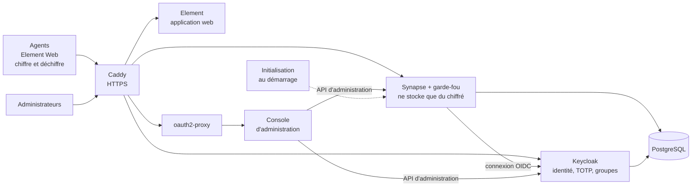

# Messagerie souveraine de l'administration

Messagerie instantanée chiffrée de bout en bout pour les agents publics du Burkina Faso : messages, groupes et fichiers, hébergée sur l'infrastructure de l'État et installée en une seule commande.

> Projet réalisé pour le sprint technique pré-hackathon du Hackathon 226, édition 2026 (MTDPCE / DGTD).

## Concept

Les agents publics échangent des informations de service sur des messageries grand public dont les serveurs échappent à l'État. Nous proposons une messagerie aussi simple à utiliser, reposant sur le protocole ouvert **Matrix** :

- **le serveur ne lit rien** : les messages et les fichiers sont chiffrés sur l'appareil de l'agent, et le serveur refuse tout contenu qui ne l'est pas ;
- **seuls les agents enrôlés entrent**, avec un mot de passe et un code à usage unique (TOTP) ;
- **un administrateur révoque un agent en un clic** (départ, perte du téléphone) : il perd l'accès sur tous ses appareils en une seconde environ, et l'opération est tracée.

## Architecture



Le chiffrement et le déchiffrement se font **uniquement sur les appareils des agents**. Tout ce qui tourne sur le serveur (Synapse, PostgreSQL, stockage des fichiers) ne manipule que du contenu chiffré. Seul Caddy est exposé ; la console et les API d'administration ne sont accessibles que par le réseau interne.

| Exigence du socle | Mise en œuvre |
|---|---|
| Chiffrement de bout en bout | Protocole Matrix **Olm/Megolm** (bibliothèque vodozemac, intégrée à Element), imposé à tous les salons ; fichiers chiffrés sur l'appareil (AES-256-CTR). **Garde-fou** côté serveur : Synapse refuse tout événement non chiffré et tout salon public. Aucune cryptographie écrite par l'équipe. |
| Hébergement souverain | `docker compose up -d` ; aucun service tiers (Element sans intégrations externes, certificats émis par l'autorité interne de Caddy, fédération désactivée). |
| Identité vérifiée | Inscription désactivée ; seuls les comptes créés dans Keycloak et membres du groupe `agents` entrent ; mot de passe et TOTP ; rôles par groupes (`agents`, `admin-messagerie`, `archiviste`). |
| Révocation immédiate | Console : compte d'identité désactivé, sessions fermées, compte de messagerie désactivé (jetons invalidés, appareils et clés supprimés, retrait des salons), puis vérification et rapport étape par étape ; journal d'audit. |
| Minimisation des métadonnées | Présence désactivée, adresses IP conservées un jour, pas d'aperçu de liens, notifications sans contenu, pas d'avatars, pas de salon public. Ce qui reste visible est listé dans les limites. |

## Technologies et licences

| Composant | Rôle | Licence |
|---|---|---|
| [Synapse](https://github.com/element-hq/synapse) | Serveur Matrix | AGPL-3.0-or-later (ou licence commerciale Element) |
| [Element Web](https://github.com/element-hq/element-web) | Client des agents | AGPL-3.0-or-later ou GPL-3.0-or-later (ou licence commerciale Element) |
| [vodozemac](https://github.com/matrix-org/vodozemac), [matrix-rust-sdk](https://github.com/matrix-org/matrix-rust-sdk), [matrix-js-sdk](https://github.com/matrix-org/matrix-js-sdk) | Chiffrement Olm/Megolm, intégrés à Element | Apache-2.0 |
| [Keycloak](https://github.com/keycloak/keycloak) | Identité, second facteur, groupes | Apache-2.0 |
| [PostgreSQL](https://www.postgresql.org) | Base de données | PostgreSQL License |
| [Caddy](https://github.com/caddyserver/caddy) | Point d'entrée HTTPS | Apache-2.0 |
| [oauth2-proxy](https://github.com/oauth2-proxy/oauth2-proxy) | Protection de la console | MIT |
| [FastAPI](https://github.com/fastapi/fastapi), [Pydantic](https://github.com/pydantic/pydantic) | Console d'administration | MIT |
| [Uvicorn](https://github.com/encode/uvicorn), [HTTPX](https://github.com/encode/httpx) | Serveur web et client HTTP de la console | BSD-3-Clause |
| [PyJWT](https://github.com/jpadilla/pyjwt), [cryptography](https://github.com/pyca/cryptography) | Vérification de la signature des jetons | MIT ; Apache-2.0 ou BSD-3-Clause |
| [SQLite](https://www.sqlite.org) | Journal d'audit | Domaine public |
| [Docker Compose](https://github.com/docker/compose) | Déploiement | Apache-2.0 |
| [pytest](https://github.com/pytest-dev/pytest), [respx](https://github.com/lundberg/respx) | Tests automatisés | MIT ; BSD-3-Clause |

## Niveau d'engagement open source : Étendre et adapter

Nous **configurons** des briques éprouvées (Synapse, Element, Keycloak, Caddy, oauth2-proxy) et nous **développons** ce qui manquait pour l'administration :

- `synapse/modules/garde_fou.py` : module Synapse (API de modules officielle) qui refuse tout contenu non chiffré, les réactions et motifs de suppression transmis en clair, et les salons publics ;
- `console-admin/` : console d'administration (liste des agents, révocation en un clic, journal d'audit), avec vérification de la signature des jetons Keycloak ;
- `init/initialiser.py` : création automatique du compte de service de la console au premier démarrage ;
- la configuration souveraine de chaque brique (`synapse/`, `keycloak/`, `element/`, `caddy/`, `docker-compose.yml`) et 22 tests automatisés.

## Installation

Prérequis : Docker et Docker Compose, environ 2 Go de mémoire libre.

```bash
docker compose up -d
```

Au premier démarrage (environ deux minutes), Keycloak importe l'annuaire de démonstration, Synapse génère sa clé de signature et le conteneur d'initialisation crée le compte de service de la console. Ensuite :

| Service | Adresse |
|---|---|
| Messagerie | https://element.localhost |
| Console d'administration | https://admin.localhost |
| Identité (administration technique) | https://auth.localhost/admin |

Les comptes fictifs, leurs codes TOTP (avec QR codes), le certificat à importer dans le navigateur et les scénarios de test sont décrits dans [DEMO.md](DEMO.md).

Tests automatisés : `pip install -r console-admin/requirements-tests.txt`, puis `pytest`.

En production : définir les secrets dans un fichier `.env` (modèle : [.env.example](.env.example)) ; remplacer les noms `*.localhost` par les noms de domaine de l'État dans `caddy/`, `synapse/`, `element/`, `keycloak/` et `docker-compose.yml` ; utiliser des certificats de l'infrastructure de clés de l'État.

## Limites connues

- **Métadonnées** : le serveur voit qui est membre de quel salon, qui envoie un message et quand, la taille des messages, les adresses IP (pendant un jour), les noms et sujets des salons et les noms des appareils. Consigne aux agents : aucune information sensible dans le nom ou le sujet d'un salon.
- **Appareil hors ligne** : un appareil éteint au moment de la révocation conserve ce qu'il avait déjà déchiffré. Il ne peut en revanche ni recevoir ni déchiffrer les nouveaux messages.
- **Captures d'écran** : impossibles à bloquer dans un navigateur ; une photo de l'écran reste toujours possible.
- **Réactions** : Element envoie les réactions (emoji) en clair ; le garde-fou les refuse, et l'agent voit alors une erreur d'envoi.
- **Prototype à un seul serveur**, client web uniquement. La cible nationale est un serveur par ministère, reliés par une fédération fermée.
- **Réintégration** d'un agent révoqué : procédure manuelle à ce stade.
- **Points critiques** : la compromission de Keycloak équivaut à celle des identités ; aucun chiffrement ne protège contre un logiciel espion installé sur l'appareil d'un agent.

## Licence

Ce projet est distribué sous licence [AGPL-3.0](LICENSE).
